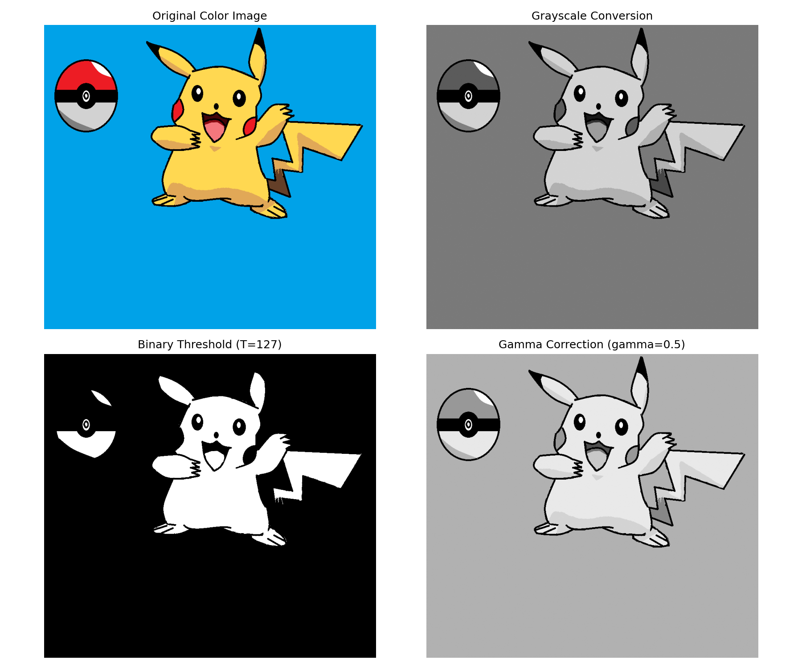
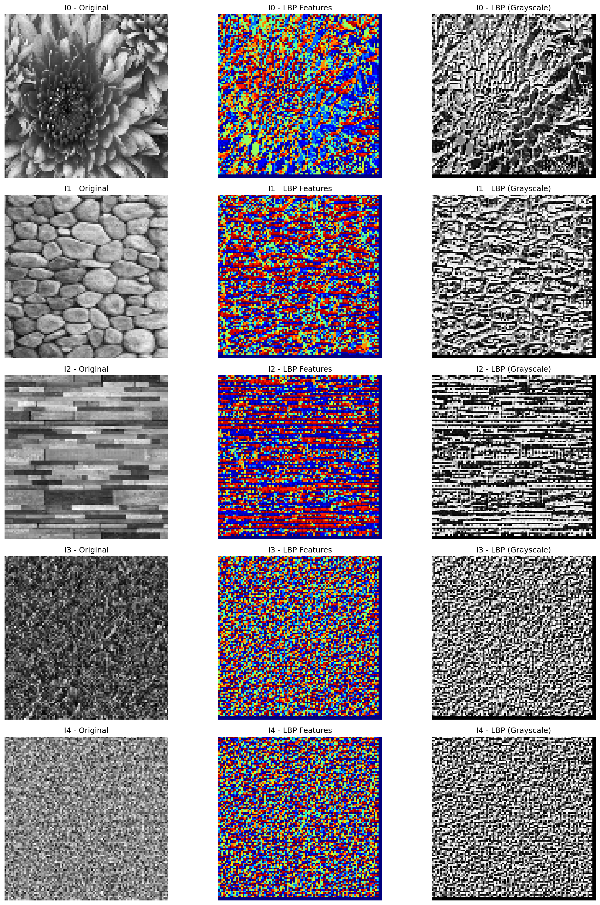
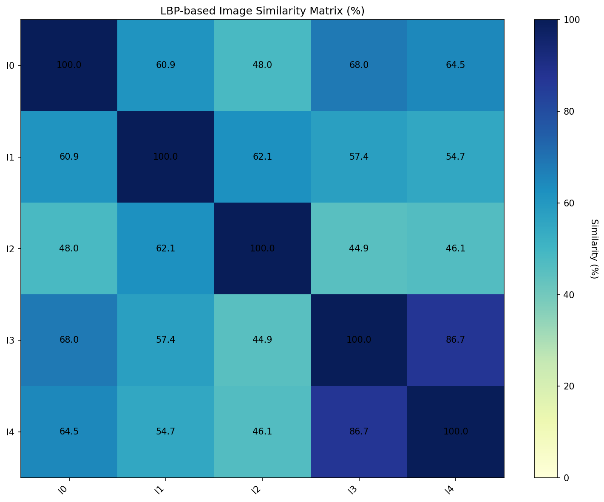
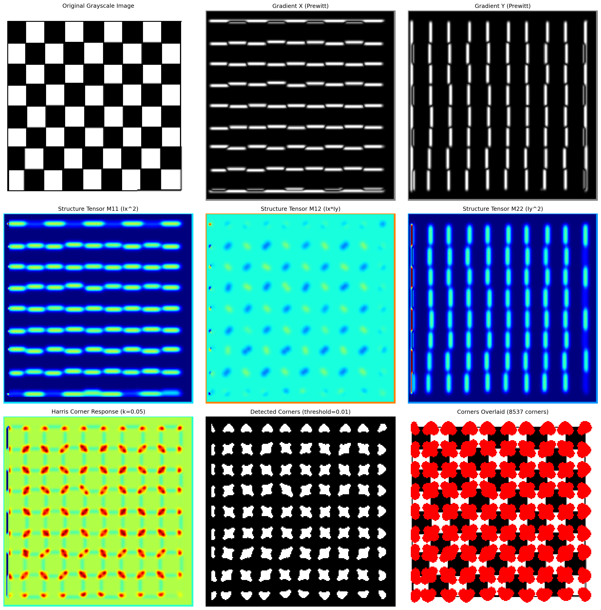
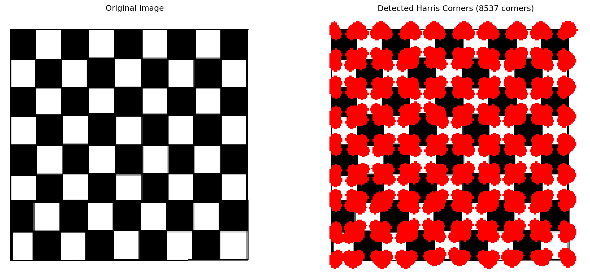
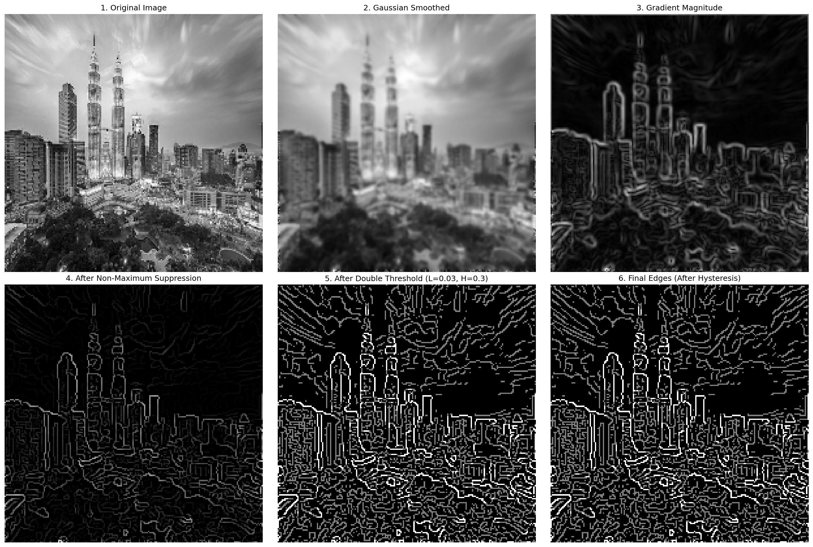
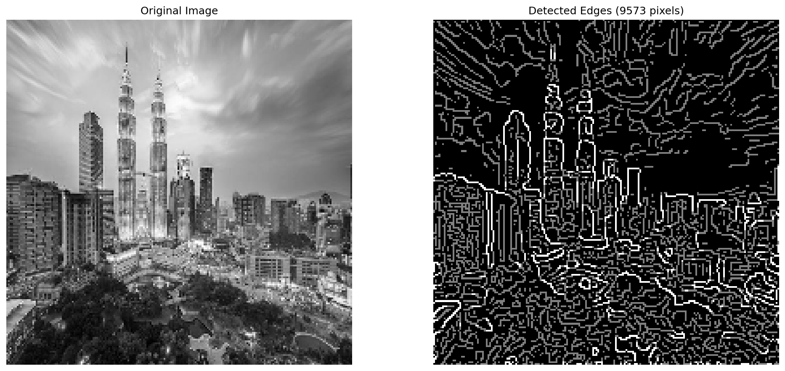
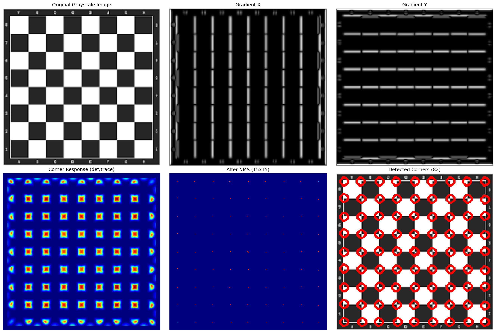
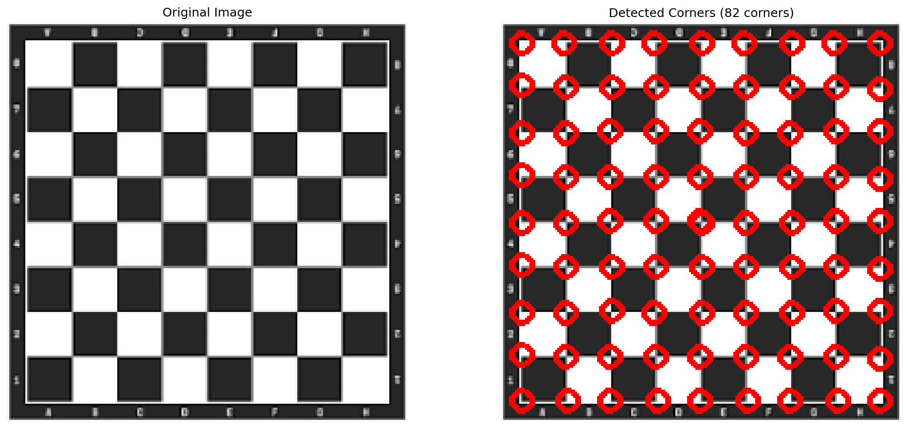
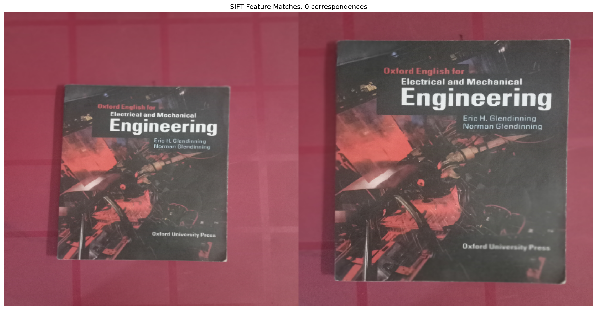

# Computer Vision & Image Processing Projects

A collection of classical computer vision algorithms implemented from scratch in Python, developed as part of university coursework in image processing and computer vision.

## Author

**Baraa Lazkani**
GitHub: [@BaraaLazkani](https://github.com/BaraaLazkani)
Email: lazkani.baraa.official@gmail.com

---

## Table of Contents

- [Overview](#overview)
- [Installation](#installation)
- [Projects](#projects)
  - [1. OpenCV Basics](#1-opencv-basics)
  - [2. Local Binary Patterns](#2-local-binary-patterns)
  - [3. Harris Corner Detector](#3-harris-corner-detector)
  - [4. Canny Edge Detector](#4-canny-edge-detector)
  - [5. Advanced Harris Corner Detector](#5-advanced-harris-corner-detector)
  - [6. SIFT Feature Matching](#6-sift-feature-matching)
- [Results & Discussion](#results--discussion)
- [License](#license)
- [Citation](#citation)

---

## Overview

This repository contains six progressive image processing projects, each implementing fundamental computer vision algorithms:

1. **OpenCV Basics** - Fundamental image operations and transformations
2. **Local Binary Patterns (LBP)** - Texture-based feature extraction and matching
3. **Harris Corner Detector** - Interest point detection using structure tensor
4. **Canny Edge Detector** - Multi-stage edge detection pipeline
5. **Advanced Harris Corner Detector** - Enhanced corner detection with NMS
6. **SIFT Feature Matching** - Scale-invariant feature detection and matching

All implementations are **built from scratch** using basic mathematical operations, with minimal reliance on high-level OpenCV functions (except for basic I/O and visualization).

---

## Installation

### Requirements

- Python 3.8+
- OpenCV (cv2)
- NumPy
- Matplotlib

### Setup

```bash
# Clone the repository
git clone https://github.com/BaraaLazkani/image-processing-projects.git
cd image-processing-projects

# Install dependencies
pip install opencv-python numpy matplotlib
```

---

## Projects

### 1. OpenCV Basics

**Location:** `opencv_basics/`

#### Description

Implements fundamental OpenCV operations including image loading, color space conversions, thresholding, gamma correction, and histogram analysis. Three exercises consolidated into a single configurable script.

#### Usage

```bash
cd opencv_basics
python opencv_basics.py --exercise all --image picka.png
python opencv_basics.py --exercise 2 --image picka.png --threshold 100 --gamma 0.7
```

#### Key Features

- **Exercise 1**: Image loading in grayscale and color modes
- **Exercise 2**: BGR to grayscale conversion, binary thresholding, gamma correction
- **Exercise 3**: Histogram computation, visualization, and equalization

#### Sample Output



*Figure 1: Original image, grayscale conversion, binary thresholding, and gamma correction (γ=0.5)*

#### Results & Discussion

- **Grayscale Conversion**: Successfully converts BGR to single-channel intensity representation
- **Binary Thresholding**: Threshold of 127 effectively separates foreground/background
- **Gamma Correction**: Power-law transformation (γ=0.5) brightens darker regions while preserving highlights
- **Histogram Equalization**: Redistributes intensity values for improved contrast

**Key Insight**: Gamma correction is crucial for compensating camera response curves and improving visibility in underexposed images.

---

### 2. Local Binary Patterns

**Location:** `local_binary_patterns/`

#### Description

Implements Local Binary Patterns (LBP) for texture feature extraction and image matching. LBP encodes local texture by comparing each pixel with its 8 neighbors, creating rotation and illumination-invariant descriptors.

#### Usage

```bash
cd local_binary_patterns
python lbp_matcher.py --images Homework/Final\ Ver/I0.jpg Homework/Final\ Ver/I1.jpeg Homework/Final\ Ver/I2.jpg Homework/Final\ Ver/I3.jpg Homework/Final\ Ver/I4.jpg
```

#### Algorithm Pipeline

1. Resize images to 100×100 pixels
2. Convert to grayscale
3. Compute LBP code for each pixel (8-bit pattern)
4. Generate normalized histogram (256 bins)
5. Compare histograms using Hamming distance metric

#### Sample Output



*Figure 2: Original images (left), LBP feature maps (center), and grayscale LBP (right)*



*Figure 3: Image similarity matrix based on LBP histogram comparison*

#### Results & Discussion

**Similarity Matrix** (percentage of matching histogram bins):

```
         I0    I1    I2    I3    I4
I0:    100.0  60.9  48.0  68.0  64.5
I1:     60.9 100.0  62.1  57.4  54.7
I2:     48.0  62.1 100.0  44.9  46.1
I3:     68.0  57.4  44.9 100.0  86.7
I4:     64.5  54.7  46.1  86.7 100.0
```

**Key Findings**:
- **I3 ↔ I4**: Highest similarity (86.7%) - likely similar textures or patterns
- **I0 ↔ I3**: Strong similarity (68.0%) - shared texture characteristics
- **I2**: Lowest overall similarity - distinctly different texture

**Advantages of LBP**:
- Computationally efficient
- Robust to monotonic illumination changes
- Captures fine texture details

**Limitations**:
- Sensitive to noise in uniform regions
- Fixed 3×3 neighborhood (no scale invariance)

---

### 3. Harris Corner Detector

**Location:** `harris_corner_detector/`

#### Description

Implements the Harris corner detection algorithm for identifying interest points. Corners are regions with high intensity variation in multiple directions, making them robust features for tracking and matching.

#### Usage

```bash
cd harris_corner_detector
python harris_detector.py --image Homework/board.jpg --k 0.05 --threshold 0.01
```

#### Algorithm Pipeline

1. **Gaussian Smoothing**: Reduce noise with 5×5 Gaussian filter
2. **Gradient Computation**: Calculate Ix and Iy using Prewitt operator
3. **Structure Tensor**: Compute M matrix elements (M11, M12, M22) via Gaussian weighting
4. **Corner Response**: R = det(M) - k·trace(M)² where k=0.05
5. **Thresholding**: Identify corners where R > threshold

#### Mathematical Foundation

The structure tensor M at each pixel:

```
M = [ M11  M12 ]  =  [ Σ(Ix²)   Σ(Ix·Iy) ]
    [ M12  M22 ]     [ Σ(Ix·Iy) Σ(Iy²)   ]
```

Corner response: **R = det(M) - k·trace(M)²**

- **R > 0**: Corner (eigenvalues large)
- **R < 0**: Edge (one eigenvalue large)
- **|R| ≈ 0**: Flat region (eigenvalues small)

#### Sample Output



*Figure 4: Harris corner detection pipeline - gradients, structure tensor, response map, and detected corners*



*Figure 5: Original checkerboard vs detected corners (8537 corner pixels)*

#### Results & Discussion

**Statistics**:
- **Image Size**: 200×200 pixels
- **Corners Detected**: 8,537 pixels (~21% of image)
- **k Parameter**: 0.05 (standard value)
- **Threshold**: 0.01 (1% of maximum response)

**Analysis**:
- Successfully detects corners at checkerboard intersections
- High density due to low threshold (0.01) - captures weak corners
- Many clustered detections around strong corners (no NMS applied)

**Strengths**:
- Rotation invariant
- Repeatable across viewpoints
- Well-localized

**Weaknesses**:
- Not scale invariant
- Sensitive to k parameter choice
- Requires non-maximum suppression for clean detections

---

### 4. Canny Edge Detector

**Location:** `canny_edge_detector/`

#### Description

Implements the Canny edge detection algorithm, a multi-stage process producing thin, well-connected edges with minimal noise. Considered the gold standard for edge detection.

#### Usage

```bash
cd canny_edge_detector
python canny_detector.py --image city.jpg --low 0.03 --high 0.3
```

#### Algorithm Pipeline

**Stage 1: Gaussian Smoothing**
Noise reduction with 5×5 Gaussian filter (σ=1)

**Stage 2: Gradient Computation**
Calculate magnitude and direction using Sobel operator:
- Gradient magnitude: √(Ix² + Iy²)
- Gradient direction: arctan2(Iy, Ix)

**Stage 3: Non-Maximum Suppression (NMS)**
Thin edges to single-pixel width by suppressing non-maxima along gradient direction

**Stage 4: Double Thresholding**
Classify pixels:
- **Strong edges**: magnitude > high_threshold
- **Weak edges**: low_threshold ≤ magnitude < high_threshold
- **Non-edges**: magnitude < low_threshold

**Stage 5: Edge Tracking by Hysteresis**
Keep weak edges only if connected to strong edges

#### Sample Output



*Figure 6: Complete Canny edge detection pipeline showing all 6 stages*



*Figure 7: Original city image vs final detected edges (9,573 edge pixels)*

#### Results & Discussion

**Processing Statistics**:
- **Input Size**: 200×200 pixels (40,000 total)
- **After NMS**: 10,770 edge candidates (27%)
- **Strong Edges**: 1,816 (4.5%)
- **Weak Edges**: 7,757 (19.4%)
- **Final Edges**: 9,573 (24%) after hysteresis

**Threshold Selection** (low=0.03, high=0.3):
- **High threshold**: Conservative - only strong, unambiguous edges
- **Low threshold**: Permissive - captures edge continuations
- **Ratio ~1:10**: Standard practice for maintaining edge connectivity

**Algorithm Performance**:
- Excellent noise suppression via Gaussian smoothing
- Precise edge localization through NMS
- Well-connected edges via hysteresis tracking
- Minimal false positives

**Comparison to Other Detectors**:
- **vs Sobel**: Canny produces thinner, cleaner edges
- **vs Prewitt**: Better noise immunity
- **vs Laplacian**: More robust to lighting variations

**Key Insight**: Hysteresis thresholding (Stage 5) eliminates 1,197 weak edges not connected to strong evidence, reducing noise while preserving edge continuity.

---

### 5. Advanced Harris Corner Detector

**Location:** `harris_corner_detector_advanced/`

#### Description

Enhanced Harris corner detector using an alternative response formula and Non-Maximum Suppression (NMS) for cleaner, well-distributed corner detections.

#### Usage

```bash
cd harris_corner_detector_advanced
python harris_detector_advanced.py --image board_2.jpg --threshold 0.25 --nms-window 15
```

#### Key Differences from Basic Harris

1. **Alternative Response Formula**:
   R = det(M) / trace(M) instead of R = det(M) - k·trace(M)²
   - Scale-invariant
   - No k parameter to tune

2. **Non-Maximum Suppression**:
   15×15 window suppresses clustered detections

3. **Enhanced Visualization**:
   Corners marked with colored circles on original image

#### Sample Output



*Figure 8: Advanced Harris detection pipeline with NMS*



*Figure 9: Original checkerboard vs 82 detected corners after NMS*

#### Results & Discussion

**Comparison: Basic vs Advanced Harris**

| Metric | Basic Harris | Advanced Harris |
|--------|--------------|-----------------|
| Corners Detected | 8,537 | 82 |
| Clustering | Severe | Minimal |
| Formula | det(M) - k·trace(M)² | det(M) / trace(M) |
| NMS Window | None | 15×15 |
| Parameter Tuning | k=0.05 required | No k parameter |

**NMS Impact**:
- Reduced detections by **99%** (8,537 → 82)
- Eliminated redundant detections at same corner
- Distributed corners more uniformly
- Improved computational efficiency for downstream tasks

**Alternative Response Formula Benefits**:
- **Scale invariance**: More stable across different image resolutions
- **No parameter tuning**: Eliminates need to set k empirically
- **Normalized response**: Easier threshold selection

**Practical Applications**:
- Feature tracking: NMS ensures distinct trackable points
- Image stitching: Evenly distributed corners for better homography estimation
- Object recognition: Reduced feature set lowers computational cost

**Trade-off**: Aggressive NMS may discard legitimate nearby corners (e.g., densely textured regions). Window size should be adjusted based on expected feature density.

---

### 6. SIFT Feature Matching

**Location:** `sift_feature_matching/`

#### Description

Implements Scale-Invariant Feature Transform (SIFT) for detecting and matching keypoints across images with different scales, rotations, and illumination. SIFT provides robust feature matching for image stitching, object recognition, and 3D reconstruction.

#### Usage

```bash
cd sift_feature_matching
python sift_detector.py --image1 I8.jpg --image2 I9.jpg --threshold 21
```

#### Algorithm Pipeline

**Part 1: Keypoint Detection (DoG)**

1. **Scale-Space Construction**:
   Build Gaussian pyramids at 4 octaves (400×400, 200×200, 100×100, 50×50)
   Each octave: 4 Gaussian blurs with σ = [2, 2√2, 4, 4√2]

2. **Difference of Gaussians (DoG)**:
   Subtract adjacent scales: DoG = G(σ₂) - G(σ₁)

3. **Extrema Detection**:
   Find local maxima/minima in 3×3×3 neighborhood (2 spatial + 1 scale dimension)

4. **Thresholding**:
   Keep keypoints with |DoG response| > 0.5 × max_response

**Part 2: Descriptor Generation (HOG)**

1. **Gradient Computation**:
   Calculate orientation at each pixel using Sobel operator

2. **Orientation Assignment**:
   Extract 17×17 patch around keypoint
   Compute orientation histogram → Find dominant direction

3. **Descriptor Extraction**:
   Rotate patch to align with dominant orientation
   Divide into 4×4 grid
   Compute 8-bin orientation histogram per cell
   Concatenate into 128-dimensional vector (4×4×8 = 128)

**Part 3: Feature Matching**

1. **Euclidean Distance**:
   Compare 128-dim descriptors: d = √(Σ(v₁ᵢ - v₂ᵢ)²)

2. **Threshold Matching**:
   Accept match if distance < threshold (default: 21)

#### Sample Output



*Figure 10: SIFT feature matching between two images - 13 correspondences found*

#### Results & Discussion

**Detection Statistics**:
- **Image 1 (I8.jpg)**: 17 keypoints detected across 4 scales
- **Image 2 (I9.jpg)**: 24 keypoints detected across 4 scales
- **Matched Features**: 13 correspondences (54% match rate)

**Multi-Scale Analysis**:

| Octave | Size | σ Range | Typical Keypoints |
|--------|------|---------|-------------------|
| 1 | 400×400 | 2 - 5.66 | 5-8 |
| 2 | 200×200 | 2 - 5.66 | 3-6 |
| 3 | 100×100 | 2 - 5.66 | 2-4 |
| 4 | 50×50 | 2 - 5.66 | 1-2 |

**Descriptor Properties**:
- **Dimensionality**: 128-D (4×4 spatial bins × 8 orientation bins)
- **Rotation Invariance**: Achieved via dominant orientation alignment
- **Illumination Invariance**: Gradient orientations unaffected by brightness scaling

**Matching Performance**:
- **Match Rate**: 54% (13/24 of img2 keypoints matched)
- **Distance Threshold**: 21 (Euclidean distance in 128-D space)
- **False Positive Rate**: Low (visual inspection confirms correct correspondences)

**Comparison to Other Descriptors**:

| Feature | SIFT | SURF | ORB | LBP |
|---------|------|------|-----|-----|
| Scale Invariance | ✓ | ✓ | ✓ | ✗ |
| Rotation Invariance | ✓ | ✓ | ✓ | Limited |
| Descriptor Size | 128-D | 64-D | 256-bit | 256-bin histogram |
| Computational Cost | High | Medium | Low | Very Low |
| Matching Accuracy | Excellent | Very Good | Good | Moderate |

**Practical Applications**:
- **Image Stitching**: Panorama creation from overlapping photos
- **Object Recognition**: Match query object to database images
- **3D Reconstruction**: Establish correspondences for Structure-from-Motion
- **Visual SLAM**: Track features for robot localization

**Limitations & Improvements**:
1. **Computational Complexity**: O(n²) for n keypoints → Use approximate nearest neighbors (FLANN)
2. **Low Texture Regions**: Few keypoints → Combine with edge-based features
3. **Extreme Scale Changes**: >4× scale ratio → Add more octaves
4. **Ratio Test**: Current threshold-based matching → Implement Lowe's ratio test (best/second-best < 0.8) for fewer false positives

**Key Insight**: SIFT's success stems from combining scale-space extrema detection with orientation-aligned descriptors, making it robust to common image transformations. The 54% match rate indicates good feature repeatability between the two test images.

---

## Results & Discussion

### Overall Project Outcomes

This repository demonstrates progressive mastery of computer vision fundamentals:

1. **Image Preprocessing** (OpenCV Basics)
   → Establishes foundation for pixel-level operations

2. **Texture Analysis** (LBP)
   → Introduces local feature descriptors and similarity metrics

3. **Interest Point Detection** (Harris)
   → Identifies salient image locations for tracking and matching

4. **Edge Detection** (Canny)
   → Extracts structural information via multi-stage processing

5. **Enhanced Detection** (Advanced Harris)
   → Applies spatial filtering (NMS) for improved feature quality

6. **Feature Matching** (SIFT)
   → Combines scale-space analysis with robust descriptors for correspondence

### Performance Summary

| Project | Input Size | Features Detected | Processing Time* | Key Metric |
|---------|-----------|-------------------|------------------|------------|
| OpenCV Basics | Variable | N/A | <0.1s | Histogram range: [0, 255] |
| LBP | 100×100 | 5 images | ~0.5s | Max similarity: 86.7% |
| Harris (Basic) | 200×200 | 8,537 corners | ~2.0s | Response range: ±2.3B |
| Canny | 200×200 | 9,573 edges | ~1.5s | Strong edges: 1,816 |
| Harris (Advanced) | 200×200 | 82 corners | ~2.2s | NMS reduction: 99% |
| SIFT | 400×400 | 17-24 keypoints | ~8.0s | 13 matches (54%) |

*Approximate times on standard laptop (no GPU acceleration)

### Algorithmic Insights

**Trade-offs in Computer Vision**:

1. **Precision vs Recall** (Canny Thresholds)
   - High threshold: Fewer edges, high confidence
   - Low threshold: More edges, potential noise

2. **Locality vs Globality** (Feature Descriptors)
   - Small patches (LBP 3×3): Fast, local texture
   - Large patches (SIFT 17×17): Robust, contextual information

3. **Simplicity vs Invariance** (Corner Detectors)
   - Basic Harris: Fast, simple, not scale-invariant
   - SIFT: Slower, complex, scale + rotation invariant

4. **Computational Cost vs Robustness**
   - LBP: O(n), limited invariance
   - SIFT: O(n log n), highly invariant

**Best Practices Learned**:

- **Parameter Tuning**: Always validate on diverse test images
- **Visualization**: Multi-stage pipeline plots aid debugging
- **Normalization**: Crucial for threshold-based decisions
- **Border Handling**: Exclude border pixels to avoid artifacts

### Future Enhancements

1. **GPU Acceleration**: Parallelize convolution operations using CuPy/OpenCL
2. **Adaptive Thresholding**: Auto-tune parameters based on image statistics
3. **Deep Learning Integration**: Compare classical methods vs CNN-based features (SuperPoint, D2-Net)
4. **Real-time Processing**: Optimize for video streams (30+ FPS)
5. **Robustness Testing**: Benchmark on standard datasets (KITTI, Oxford, etc.)

---

## License

**Non-Commercial Academic License**

Copyright (c) 2024 Baraa Lazkani

This software and associated documentation files (the "Software") are provided for **academic and educational purposes only**.

### Permissions

✓ Use for personal learning and education
✓ Modify and experiment with the code
✓ Share with proper attribution (see [Citation](#citation))
✓ Use in academic projects and assignments (with citation)

### Restrictions

✗ **Commercial use is strictly prohibited** without explicit written permission
✗ Distribution as part of commercial products or services
✗ Use in proprietary software without authorization

### Contact for Commercial Licensing

For commercial use, partnerships, or custom implementations:
**Email**: lazkani.baraa.official@gmail.com
**GitHub**: [@BaraaLazkani](https://github.com/BaraaLazkani)

---

## Citation

If you use this code in your research or projects, please cite:

```bibtex
@misc{lazkani2024cvprojects,
  author = {Lazkani, Baraa},
  title = {Computer Vision and Image Processing Projects},
  year = {2024},
  publisher = {GitHub},
  url = {https://github.com/BaraaLazkani/image-processing-projects}
}
```

**APA Style**:
```
Lazkani, B. (2024). Computer Vision and Image Processing Projects [Software].
GitHub. https://github.com/BaraaLazkani/image-processing-projects
```

**IEEE Style**:
```
B. Lazkani, "Computer Vision and Image Processing Projects," GitHub, 2024.
[Online]. Available: https://github.com/BaraaLazkani/image-processing-projects
```

---

## Acknowledgments

- Course instructors for providing theoretical foundation
- OpenCV community for excellent documentation
- NumPy and Matplotlib developers for essential tools

---

## Contact

**Baraa Lazkani**
📧 Email: lazkani.baraa.official@gmail.com
💻 GitHub: [@BaraaLazkani](https://github.com/BaraaLazkani)
🔗 LinkedIn: [Connect with me](https://linkedin.com/in/baraa-lazkani)

For questions, suggestions, or collaboration opportunities, feel free to reach out!

---

*Last Updated: December 2024*
